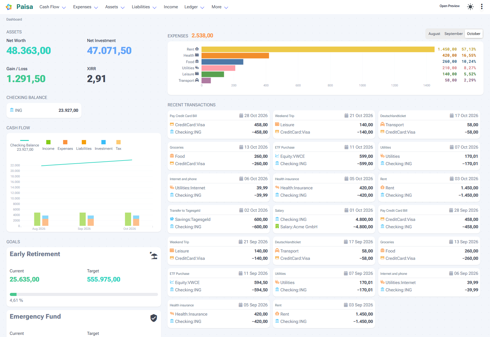
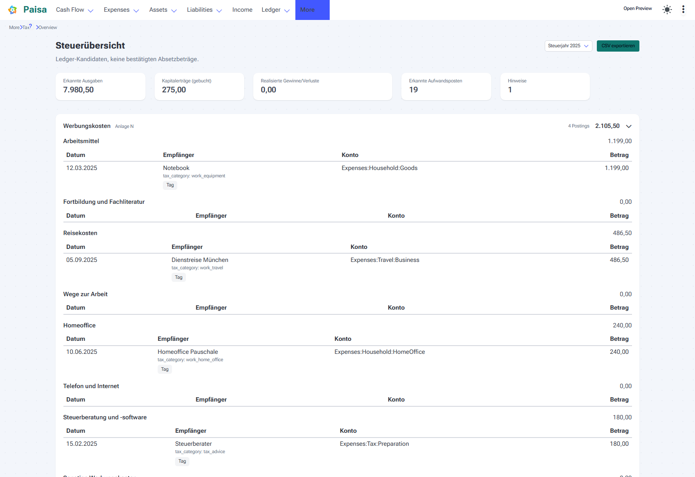

<div align="center">
  
  <h1>Paisa</h1>
  <p><strong>Personal finance manager on plain-text double-entry accounting</strong></p>

<a href="./COPYING"></a>
<a href="https://github.com/Aerics84/paisa/commits/master"></a>


<a href="https://github.com/Aerics84/paisa/pkgs/container/paisa"></a>
<a href="https://github.com/ananthakumaran/paisa"></a>

</div>

> [!NOTE]
> **Paisa was created by [Anantha Kumaran](https://github.com/ananthakumaran) ([ananthakumaran/paisa](https://github.com/ananthakumaran/paisa)).** This is the [Aerics84](https://github.com/Aerics84) fork: actively developed, with bug fixes and a focus on the German and European market. Journals and configuration stay compatible with upstream.

Paisa reads a plain-text journal written in [ledger](https://www.ledger-cli.org/), [hledger](https://hledger.org/) or [beancount](https://beancount.github.io/), and turns it into a local-first personal finance dashboard: net worth, cash flow, expenses, investments, goals, budgets and taxes. Your data stays in a file you own — no cloud account, no bank sync, no vendor lock-in.



## Why this fork?

| Highlight                                    | Details                                                                                                                                                                                                                                                                                                                  |
| -------------------------------------------- | ------------------------------------------------------------------------------------------------------------------------------------------------------------------------------------------------------------------------------------------------------------------------------------------------------------------------ |
| **Actively developed**                       | Versions 0.8 through 0.8.6 since April 2026: features, fixes and dependency updates land continuously. See the [changelog](./CHANGELOG.md).                                                                                                                                                                              |
| **Built for Germany and Europe**             | German tax regime with a capital income report (annual allowance, capital income tax, solidarity surcharge, optional church tax) and an annual tax overview that groups deductible expenses by return section (`Anlage N`, `Anlage Vorsorgeaufwand`, `Hauptvordruck`, `Anlage KAP`) with coverage checks and CSV export. |
| **Imports that fit local banks and brokers** | CAMT.053 and MT940 bank statements, Trade Republic and Scalable Capital exports, and generic German/EU broker templates. `paisa init --regional-profile germany-eu` generates a ready-to-run EUR setup.                                                                                                                  |
| **Correct numbers for European data**        | Decimal-comma amount parsing, EUR metal prices from the Yahoo EU provider, timezone-aware journal dates, hledger `acost` cost basis, GBp/GBX normalisation and transfer-aware savings rates.                                                                                                                             |
| **Sharper dashboards**                       | Total and invested savings rates with a 20 % guideline, expense subcategory drilldown, and a preview dashboard with a selected-month review: net income trend, top/flop positions, checking account history and Sankey flows.                                                                                            |
| **Fixes and hardening**                      | Untrusted HTML removed, per-IP rate limiting, SQLite WAL and backup pruning, concurrency-safe price cache, safer import template handling, CRLF-aware account renames and Yahoo cookie/crumb authentication.                                                                                                             |
| **Modern base**                              | Svelte 5, Bulma 1, Vite 8 and Go 1.24, with upstream v0.7.8 (including its security fix) merged.                                                                                                                                                                                                                         |

### Germany tax overview

Deductible expense candidates grouped by return section, with coverage checks, raw `Anlage KAP` values and CSV export:



Both screenshots are taken from this fork with the `germany-eu` starter profile. The tax page labels are German because they mirror the official form sections; navigation and configuration stay English.

## Features

- **Journal formats:** ledger, hledger and beancount, including file includes, prices, balance assertions and strict mode.
- **Analysis:** net worth, cash flow, income statement, expenses with month/subcategory drilldown, liabilities and credit cards.
- **Investments:** holdings, portfolio performance, XIRR, allocation targets, capital gains and configurable price providers.
- **Goals:** retirement and savings goals with projections and contribution planning.
- **Planning:** budgets, recurring transactions, upcoming expenses and notepad-style [sheets](https://paisa.fyi/reference/sheets/).
- **Import:** CSV, XLSX and PDF statements, password-protected files, reusable templates, CAMT.053, MT940 and broker exports.
- **Tax:** Germany capital income reporting and annual tax overview; India tax harvesting, capital gains and Schedule AL.
- **Editing:** built-in journal editor with format/save shortcuts, bulk edit, and account renaming across the journal.
- **Access:** web UI, desktop app, optional user accounts, and read-only mode for demos.

## Quick start

### Docker

Images are published at `ghcr.io/aerics84/paisa`:

- `ghcr.io/aerics84/paisa:latest` — Paisa with `ledger`
- `ghcr.io/aerics84/paisa:latest-hledger` — adds `hledger`
- `ghcr.io/aerics84/paisa:latest-beancount` — adds `beancount`
- `ghcr.io/aerics84/paisa:latest-all` — adds both `hledger` and `beancount`

```bash
docker run --rm -p 7500:7500 -v "$HOME/Documents/paisa:/root/Documents/paisa" ghcr.io/aerics84/paisa:latest
```

Then open [http://localhost:7500](http://localhost:7500).

To try Paisa with sample data first:

```bash
docker run --rm -p 7500:7500 ghcr.io/aerics84/paisa:latest-demo
```

### From source

Build requirements: Go 1.24+, Node 24+, npm 12+ and a C toolchain for SQLite (`gcc`/`clang`). Beancount journals additionally require `beancount>=3.2.3` and `beanquery>=0.2.0` on `PATH` (`bean-check` and `bean-query`).

```bash
git clone https://github.com/Aerics84/paisa.git
cd paisa
npm install
npm run build
go build

mkdir ~/Documents/paisa && cd ~/Documents/paisa
/path/to/paisa init --regional-profile germany-eu
/path/to/paisa serve
```

`paisa init --regional-profile germany-eu` creates an EUR starter journal and configuration. Use `--regional-profile india` for the upstream default.

This fork does not publish prebuilt binaries yet; use the Docker images or build from source. The binaries from [upstream releases](https://github.com/ananthakumaran/paisa/releases) are upstream builds and do not contain the fork features described above.

## Documentation

- General documentation: [paisa.fyi](https://paisa.fyi)
- Germany tax overview: [docs/reference/tax/deductions.md](./docs/reference/tax/deductions.md)
- Germany capital income: [docs/reference/tax/capital-income.md](./docs/reference/tax/capital-income.md)
- Configuration reference: [docs/reference/config.md](./docs/reference/config.md)
- What changed in this fork: [CHANGELOG.md](./CHANGELOG.md)

## Development

`npm install` configures repo-local Git hooks automatically.

- `git commit` formats staged Prettier-supported files and re-stages them.
- `git push` runs the critical pre-push checks from `scripts/preflight-critical.mjs`.
- `npm run format:changed` formats locally changed files on demand.

The pre-push check validates changed-file formatting, the Svelte/TypeScript check, targeted import and regression tests, the frontend production build, and the Go build.

If a staged file also has unstaged edits, the commit hook stops instead of silently staging extra hunks. In that case, format the file first and stage it again.

Useful commands:

```bash
npm run dev        # frontend dev server
go run . serve     # backend with the built frontend
npm run check      # Svelte and TypeScript checks
go test ./...      # Go tests
```

## Community and contributing

- Bug reports and feature requests: [Aerics84/paisa issues](https://github.com/Aerics84/paisa/issues)
- Chat: [Matrix `#paisa:matrix.org`](https://matrix.to/#/#paisa:matrix.org) (shared with the upstream community)
- Upstream discussions: [ananthakumaran/paisa discussions](https://github.com/ananthakumaran/paisa/discussions)

Pull requests are welcome. Please keep changes focused, add a test where it makes sense, and run the pre-push checks before opening a PR.

## Credits and license

Paisa is designed and originally created by **[Anantha Kumaran](https://github.com/ananthakumaran)**. This fork builds on that work and thanks the upstream author and community.

This software is licensed under the [GNU AGPL 3 or later](./COPYING). If you run a modified version as a network service, the AGPL requires you to make the corresponding source available.
